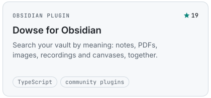
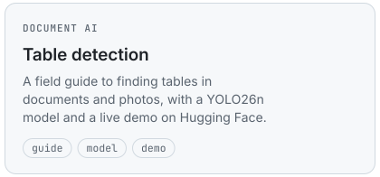
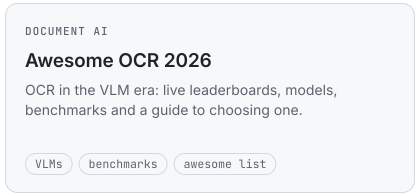
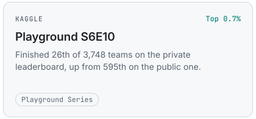
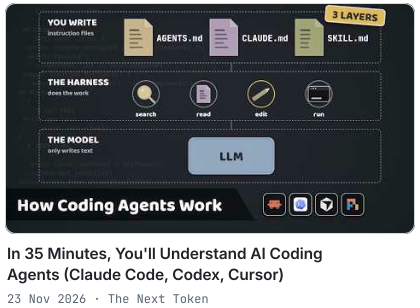
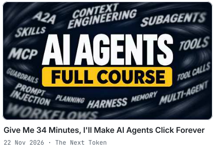

<a href="https://www.youtube.com/@TheNextTokenLab">
<picture><source media="(prefers-color-scheme: dark)" srcset="assets/banner-dark.svg"></picture>
</a>

<samp>
<a href="https://www.youtube.com/@TheNextTokenLab">youtube</a> ·
<a href="https://walidhadri.medium.com/">medium</a> ·
<a href="https://huggingface.co/walidhadri">hugging&nbsp;face</a> ·
<a href="https://www.kaggle.com/walidhadri">kaggle</a> ·
<a href="https://dev.to/walid_hadri">dev.to</a> ·
<a href="https://www.linkedin.com/in/walid-hadri-16438b175/">linkedin</a> ·
<a href="https://walidhadri-iron.github.io/">site</a>
</samp>

Forward Deployed Engineer and AI engineer in Paris, trained in applied maths at CentraleSupélec. I work on document AI and LLM agents, build local-first search tools, and explain how language models work on [The Next Token](https://www.youtube.com/@TheNextTokenLab).

## Building

<a href="https://github.com/WalidHadri-Iron/dowse"><picture><source media="(prefers-color-scheme: dark)" srcset="assets/cards/dowse-dark.svg"></picture></a>

<a href="https://github.com/WalidHadri-Iron/dowse-obsidian"><picture><source media="(prefers-color-scheme: dark)" srcset="assets/cards/dowse-obsidian-dark.svg"></picture></a><a href="https://github.com/WalidHadri-Iron/awesome-table-detection-2026"><picture><source media="(prefers-color-scheme: dark)" srcset="assets/cards/table-detection-dark.svg"></picture></a>
<a href="https://github.com/WalidHadri-Iron/awesome-ocr-2026"><picture><source media="(prefers-color-scheme: dark)" srcset="assets/cards/awesome-ocr-dark.svg"></picture></a><a href="https://www.kaggle.com/walidhadri"><picture><source media="(prefers-color-scheme: dark)" srcset="assets/cards/kaggle-dark.svg"></picture></a>

Table detection on Hugging Face: <a href="https://huggingface.co/walidhadri/table-detection-yolo26n">YOLO26n model</a> · <a href="https://huggingface.co/spaces/walidhadri/table-detection-yolov26">live demo</a> · <a href="https://walidhadri.medium.com/table-detection-in-2026-a-practical-guide-to-models-datasets-and-weights-141e881619c8">the guide on Medium</a>

## Latest from The Next Token

<!-- VIDEOS:START -->

<a href="https://www.youtube.com/watch?v=cLMOE6Vl8jQ"><picture><source media="(prefers-color-scheme: dark)" srcset="assets/videos/video-1-dark.svg"></picture></a><a href="https://www.youtube.com/watch?v=qNbfTr6f2DA"><picture><source media="(prefers-color-scheme: dark)" srcset="assets/videos/video-2-dark.svg"></picture></a>

<!-- VIDEOS:END -->

<a href="https://www.youtube.com/@TheNextTokenLab/videos">All videos</a>

## Writing

<!-- WRITING:START -->

- <samp>27 Nov 2026</samp> &nbsp;[This free tool will turn a GitHub link into diagrams and video explainers](https://walidhadri.medium.com/this-free-tool-will-turn-a-github-link-into-diagrams-and-video-explainers-9eca87a8bd94)
- <samp>25 Nov 2026</samp> &nbsp;[How to stop hitting Claude Code limits so quickly](https://walidhadri.medium.com/how-to-stop-hitting-claude-code-limits-so-quickly-85bd13be3c9b)
- <samp>24 Nov 2026</samp> &nbsp;[OCR in 2026: which models to run, what they cost, and how they compare](https://walidhadri.medium.com/ocr-in-2026-which-models-to-run-what-they-cost-and-how-they-compare-59579f0ac1b0)
- <samp>23 Nov 2026</samp> &nbsp;[What happens inside an AI coding agent](https://medium.com/data-science-collective/what-happens-inside-an-ai-coding-agent-962828b360ab)
- <samp>23 Nov 2026</samp> &nbsp;[Inside Anthropic’s FDE courses: what you study and how you’re assessed](https://walidhadri.medium.com/inside-anthropics-fde-courses-what-you-study-and-how-you-re-assessed-7eab887f6c87)

<!-- WRITING:END -->

<a href="https://walidhadri.medium.com/">More on Medium</a>

Earlier work, 2020 to 2022

- [Optimisation](https://github.com/WalidHadri-Iron/OptimisationProjects): air-traffic rerouting, truck platooning and vehicle routing with time windows, as mixed-integer programs in Gurobi and Julia. [Article](https://walidhadri.medium.com/the-air-traffic-flow-management-rerouting-problem-534fbcc3e977)
- [Machine learning lectures](https://github.com/WalidHadri-Iron/MachineLearningLectures): classical ML with the maths worked through
- [Valorant](https://github.com/WalidHadri-Iron/Valorant-Project): object detection with YOLO and with template matching
- [Search engine](https://github.com/WalidHadri-Iron/SimpleSearchEngine): a TF-IDF search app, built as a school project with BNP Paribas
- [Portfolio backtesting](https://github.com/WalidHadri-Iron/BacktestingPortfolio): Monte Carlo portfolio optimisation and rebalancing strategies
- [Data structures and algorithms](https://github.com/WalidHadri-Iron/DSA), including Project Euler solutions
- [Scraping](https://github.com/WalidHadri-Iron/MLScraping), [Selenium](https://github.com/WalidHadri-Iron/SeleniumProjects) and [file parsing](https://github.com/WalidHadri-Iron/ParsingFiles) automations

